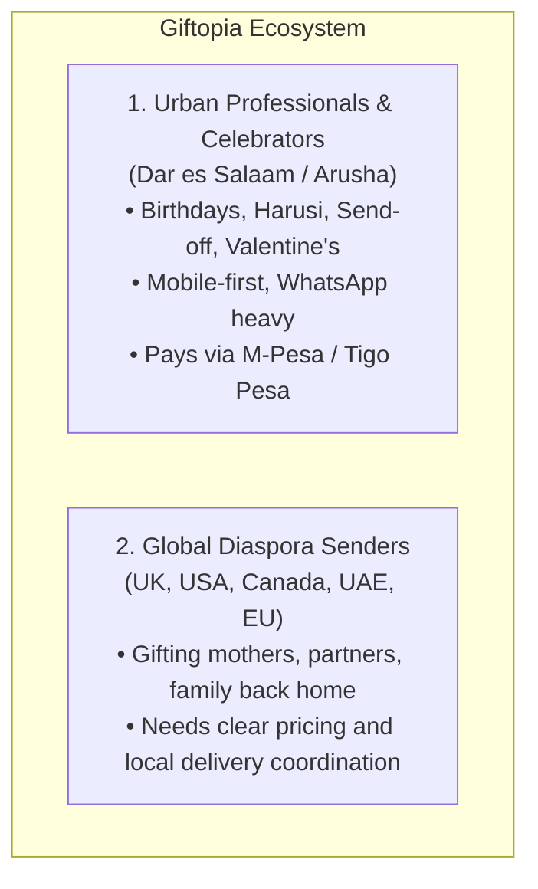
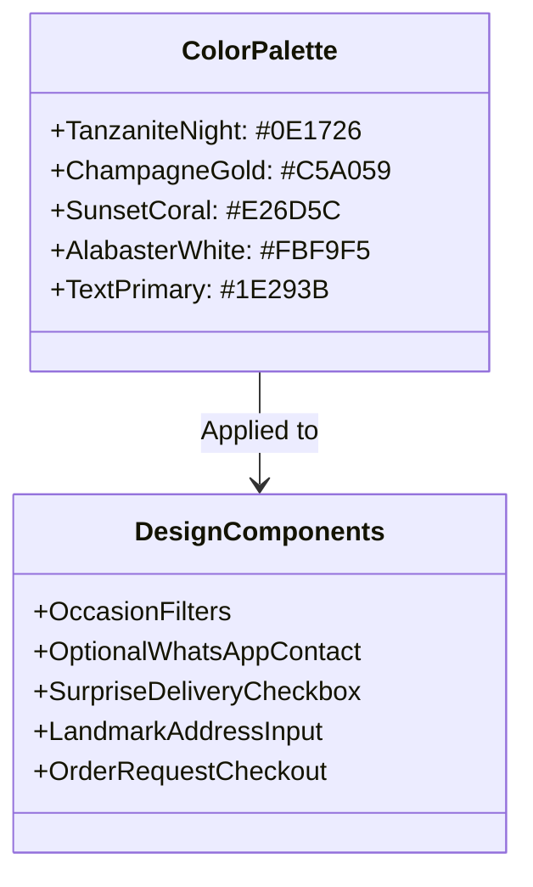

# Giftopia — Brand Identity, UI/UX Strategy & Design System for Tanzania

## 1. Market Context & Target Audience

In Tanzania (primarily Dar es Salaam, Arusha, Zanzibar, Mwanza, Dodoma), gifting is deeply rooted in relationship building, respect, and communal celebration (*Undugu*, *Ukarimu*, and *Kusherehekea*). Giftopia's current consumer focus is local buyers and diaspora senders arranging gifts for recipients in Tanzania. Corporate gifting is deferred.



Current product pages show approximate USD equivalents but do not offer currency switching, card processing, delivery-time guarantees, or handover-photo promises. Checkout records an order request and preferred payment method for follow-up.

### Key Tanzanian Market Realities
1. **Address Systems are Landmark-Based**: Standard street addresses are rarely used in Dar es Salaam. People deliver using landmarks (*"Kinondoni Manyanya karibu na Best Bite"*, *"Mikocheni B nyuma ya Shoppers Supermarket"*). The checkout must accommodate landmark inputs rather than rigid zip codes.
2. **WhatsApp is the Business OS**: Customers browse on mobile, but want to talk to a human for custom cards, swaps, or delivery status.
3. **Surprise Factor (*Zawadi ya Kushtukiza*)**: A massive portion of gifts are surprises. The delivery rider must **not** reveal the contents or who sent it when calling for directions.
4. **Mobile Money Dominance**: Vodacom M-Pesa (Lipa Namba / Till), Tigo Pesa / Mix, Airtel Money, and Halopesa represent over 80% of local digital payments.
5. **Presentation Over Everything**: A gift in Tanzania is judged instantly by its packaging, ribbon quality, and unboxing appeal (frequently shared on Instagram Stories and WhatsApp Status).

---

## 2. Brand Positioning & Identity

- **Brand Name**: **Giftopia** (Derives from the Swahili root *Urembo* — elegance, beauty, and refinement).
- **Core Brand Essence**: *"Curated Moments, Delivered with Care"* / *"Zawadi Zenye Thamani, Kumbukumbu za Milele"*.
- **Brand Personality**: Warm, Prestigious, Thoughtful, Culturally Grounded, and Reliable.
- **Tone of Voice**:
  - *Swahili*: Heshima, Ukarimu, Uaminifu (Respectful, hospitable, dependable).
  - *English*: Warm luxury, effortless, prompt, celebratory.

---

## 3. Recommended Color Palettes

The current dusty blush pink (`#d59697`) feels too much like a generic foreign cosmetic blog. For Tanzania, colors should convey prestige, celebration, warm East African hospitality, and trustworthiness.

```carousel
### Option 1: Tanzanite & Royal Champagne (Recommended)
**Why it works**: Combines the national prestige of the Tanzanite gemstone with luxury champagne gold. Conveys trustworthiness and appeals to local buyers and diaspora senders.

- **Primary Brand (Deep Tanzanite Night)**: `#0E1726` (Deep slate navy)
- **Luxury Accent (Champagne Gold)**: `#C5A059` / `#D4AF37` (Ribbon gold, badges, CTAs)
- **Warmth / Celebration (Sunset Hibiscus)**: `#D9534F` or `#E26D5C` (Offer tags, hearts, festive highlights)
- **Background (Warm Pearl)**: `#FBF9F5` (Soft ivory canvas)
- **Surface / Card (Pure Crisp White)**: `#FFFFFF`
- **Text & Contrast**: `#1E293B` (Headings) & `#64748B` (Subtext)
<!-- slide -->
### Option 2: Safari Savannah & Terracotta Ochre
**Why it works**: Evokes handcrafted artisan authenticity, Serengeti warmth, organic coffee, Zanzibar spices, and rich dried fruits.

- **Primary Brand (Deep Acacia Green)**: `#14342B` (Lush botanical tone)
- **Secondary (Terracotta Ochre)**: `#C4683C` (Warm clay earth)
- **Accent (Sunlit Amber)**: `#EAA844` (Friendly, radiant)
- **Background (Soft Sand)**: `#F7F4EE`
- **Card / Surface**: `#FFFFFF`
- **Text**: `#262B28` & `#616B66`
<!-- slide -->
### Option 3: Velvet Maroon & Warm Brass
**Why it works**: Deeply romantic, traditional, and regal. Ideal for high-end wedding hampers, send-offs, and luxury celebrations.

- **Primary Brand (Royal Plum/Maroon)**: `#4A1525`
- **Accent (Warm Polished Brass)**: `#D6A85D`
- **Sub-accent (Soft Rose Petal)**: `#F4D3C4`
- **Background (Vintage Cream)**: `#FAF7F2`
- **Text**: `#2B141C` & `#705961`
```

> [!TIP]
> **Recommendation**: **Option 1 (Tanzanite & Royal Champagne)** is the strongest for Giftopia. It makes the brand feel warm and dependable while keeping gift packaging bespoke.

---

## 4. Typography System

| Role | Font Family | Weight | Purpose |
| :--- | :--- | :--- | :--- |
| **Display / Headings** | `Playfair Display` or `Cinzel` | Bold (700) / SemiBold (600) | Timeless, editorial, luxury gift perception |
| **Body / UI & Numbers** | `Plus Jakarta Sans` or `Inter` | Regular (400) / Medium (500) | Exceptional legibility on mobile screens, clean numbers for TZS currency |
| **Accents / Swahili Taglines** | `Playfair Display Italic` | Italic (400) | Emotional resonance, greeting card quotes |

---

## 5. UI/UX Improvements Tailored for Tanzania

### A. Mobile-First Navigation & WhatsApp Ordering
1. **Floating WhatsApp Assist Button**:
   - Fixed at bottom-right on mobile screens.
   - Provides a direct contact link only when a valid `WHATSAPP_NUMBER` is configured.
2. **Product-specific WhatsApp inquiry**:
   - Each product link includes its name and TZS price in a prefilled message; it is an inquiry, not a confirmed order.

### B. Delivery Address: Landmark-Based Fields
Standard e-commerce forms demand "Street Address line 2" and "Postal Code". In Tanzania, that causes drop-offs.
- **Region / City**: Dar es Salaam, Arusha, Dodoma, Zanzibar, Mwanza.
- **Neighborhood / Area**: e.g., Mikocheni, Masaki, Sinza, Kinondoni, Mbezi Beach, Tegeta, Ilala, Kariakoo.
- **Landmark / Directions**: *"Karibu na kituo cha mwendokasi au jengo maarufu"* (e.g., Near Total Energies, opposite Shoppers).
- **"Zawadi ya Kushtukiza" (Surprise Delivery) Toggle**:
  - Checkbox: *[x] Ni zawadi ya kushtukiza (Mpigie simu akiwa getini tu / Do not spoil the surprise!)*

### C. Gifting Occasions Bar (Swahili & English)
The storefront currently supports birthday, love, celebrations, gratitude, and Tanzanian keepsakes. Additional occasion categories should wait until the catalog contains matching products.

### D. Diaspora Pricing Clarity
- TZS is the primary catalog and checkout currency; USD equivalents are approximate.
- Do not promise payment processing, live conversion, or delivery photo proof until those services are integrated.

### E. Checkout Payment Clarity
- Checkout records the selected payment preference and an order request only.
- No Lipa Namba instructions, card gateway, or payment processing is currently integrated; confirm payment details separately with the customer.

---

## 6. Visual Component Mockup (Design System Tokens)



---

## 7. Implementation Status

The storefront and admin use the recommended Tanzanite and Champagne palette. Mobile navigation, occasion filters, landmark-based checkout fields, surprise-delivery selection, product-specific WhatsApp inquiries, and approximate USD pricing are implemented. Payment gateways, delivery guarantees, and handover-photo commitments remain out of scope until operationally supported.
